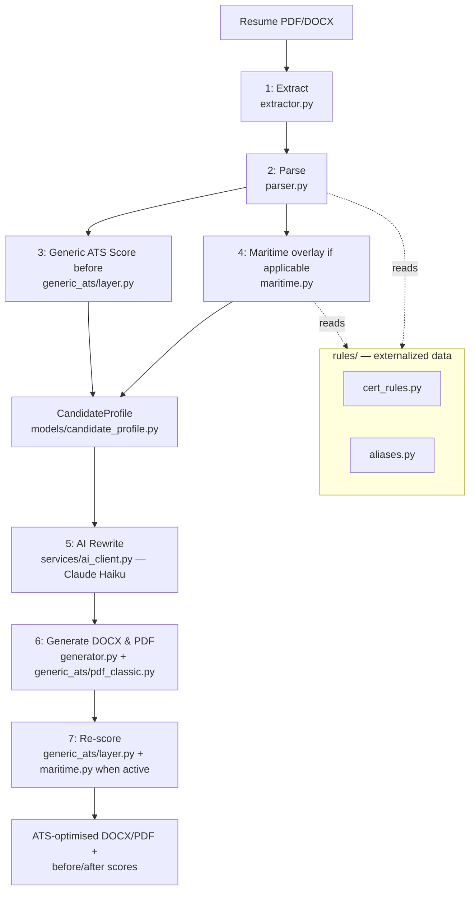

# CLAUDE.md

This file provides guidance to Claude Code (claude.ai/code) when working with code in this repository.

Source of truth for the narrative below: `MYC_ATS_Technical_Architecture.docx` (accurate, validated against 269 real candidate resumes), reconciled with the current codebase after the production-hardening pass described in Task 8's commit history.

## Project Overview

Marine ATS — a two-layer resume scoring and rewriting service for Indian seafarer and general resumes, embedded in Marine Your Career's app via REST endpoints — submit for the full scored + AI-rewritten result, or score for a fast, LLM-free scores-only check (see "API reference" for the complete, current list; plus operational/admin/health endpoints).

The system operates in two clean layers:
1. **Layer 1 — Generic ATS Base** (merged from Resume Matcher):
   - Deterministic composite ATS scoring (keyword match 40%, skills coverage 20%, title match 15%, section completeness 15%, date consistency 10%)
   - Deterministic parse checks (`generic_ats/ats_parse` — text layer, garbled glyphs, multi-column, tables, text boxes, images, contact info, headings, date consistency)
   - Claude-powered tailoring and regeneration (`generic_ats/prompts.py`, `generic_ats/writing_quality.py`) with strict anti-hallucination rules, AI buzzword scrubbing, em-dash sanitization, and prompt injection filtering
   - Clean, ATS-compliant single-column PDF generation (`generic_ats/pdf_classic.py`) supporting multiple styles (classic, modern, minimal) without Chromium/Playwright dependencies.
2. **Layer 2 — Maritime Domain Overlay**:
   - The specialized maritime scoring (`pipeline/maritime.py`), certificate detection, sea service extraction, and rank detection in `pipeline/` and `rules/` sit on top.
   - Activates when `career_track` is passed or for maritime rank workflows.
   - Enforces regulatory compliance: valid STCW/CoC certificates (eligibility gate), unbroken sea service records (verification layer), and vessel type experience (differentiation layer).

The system ingests a raw resume PDF or DOCX, scores it against both general ATS rules and maritime-specific domain rules, rewrites it using Claude, and outputs a clean, ATS-compliant DOCX/PDF — with a measurable before/after score on both scales.

**Legacy validation baseline**: the original single-layer scorer processed 269 real candidate resumes end-to-end with zero pipeline errors. Its recorded averages were ATS 63.4→69.1/100 and maritime 54.1→70.7 (on the /65 base + /20 bonus scale); resumes with 0 sea-months detected dropped from 56 to 2, and ATS FAIL grades from 82 to 1. These results predate the Resume Matcher generic scoring integration. The new two-layer scorer has unit coverage but has not yet been batch-validated against all 269 resumes, so do not present the legacy numbers as its measured results.

## Architecture

A modular monolith: FastAPI + SQLite (WAL) + `BackgroundTasks` + Claude (Anthropic API), single VPS deployment, single client. PostgreSQL/Celery/Redis/multi-tenancy are deliberately deferred, not oversights — see "Explicitly out of scope" below for the specific trigger conditions that would justify revisiting each one; none has been hit.



Only Stage 5 (AI Rewrite) is non-deterministic. Both scoring layers are rules and math; the maritime layer's issue strings trace to named maritime rules. The old scorer's `[R1]`–`[R42]` labels remain relevant to legacy regression tooling only.

### Pipeline stages (in `pipeline/` and `generic_ats/`)

| # | Stage | File | What it does | Tech |
|---|---|---|---|---|
| 1 | Extract | `pipeline/extractor.py` | Reads PDF/DOCX, detects two-column layouts, reconstructs reading order using word x/y coordinates. Flags structural ATS violations (tables, headers/footers, images, scanned PDFs). | pdfplumber, python-docx |
| 2 | Parse | `pipeline/parser.py` | Extracts name, contact, sections, skills, rank. Pulls sea-service months from PDF service-record tables (`extract_sea_months`), with a text-based fallback (`extract_sea_months_from_text`) for when there's no PDF — e.g. re-scoring a generated DOCX. | spaCy (`en_core_web_lg`), regex, `python-dateutil` |
| 3 | Generic ATS Score | `services/two_layer.py` + `generic_ats/` | Always-on Resume Matcher-compatible score: 40% parse/layout checks + 60% content score (keywords, skills, title, sections, dates). | Deterministic rules and whole-term keyword matching |
| 4 | Maritime Overlay | `services/two_layer.py` + `pipeline/maritime.py` | Optional maritime rules for certs, sea service, vessel types, and rank. Activates for a detected seafarer rank or explicit maritime target fields. | Custom rule engine over `rules/cert_rules.py`, `rules/aliases.py` |
| 5 | AI Rewrite | `services/ai_client.py` | Claude rewrites summary, bullets, skills, certs to ATS spec. Raw-text fallback for garbled resumes. Retries transient API failures with exponential backoff. Writing quality and buzzwords scrubbed via `generic_ats/writing_quality.py`. | Anthropic Claude Messages API |
| 6 | Generate | `pipeline/generator.py` & `generic_ats/pdf_classic.py` | Builds clean single-column DOCX (Arial, no tables, no images) and ATS PDF (ReportLab single-column classic/modern/minimal). | python-docx, reportlab |
| 7 | Re-score | `services/two_layer.py` | Re-runs the generic score and, if active before rewriting, the maritime overlay against the generated output. | — |

**Entry points:**
- `main.py` — CLI, single resume: `venv/bin/python main.py <resume_path> [job_description]`. Still the manual single-resume testing path; every change in this repo must keep it working.
- `api.py` — FastAPI service, the production path MYC's app calls.
- `pipeline/batch_processor.py` — batch-processes a list of local resumes (`data/resume_file_list.txt`) for regression testing against the 269-resume validation set. Outputs `data/outputs/batch_results.csv` / `.json`.
- `training/prelabel.py` — offline pre-labeling tool (Ollama/qwen2.5:7b) used to build training data for a possible future custom NER model (see Roadmap). Not part of the live pipeline.

`Resume-Matcher-main/` is a local upstream reference checkout, not a runtime dependency or part of this service's deployment. The integrated, self-contained subset is `generic_ats/` plus `services/two_layer.py`; the upstream app's frontend, database, queue, and unrelated endpoints are intentionally not merged into this service.

### Folder structure

```
.
├── api.py                    # FastAPI service — the REST endpoints MYC's app calls (see "API reference")
├── main.py                   # CLI entry point for manual single-resume testing
├── config.py                 # API keys, model names, scoring weights/thresholds — single source
├── generic_ats/              # Layer 1: Generic ATS engine (from Resume Matcher)
│   ├── ats.py                # 5-part composite ATS scoring
│   ├── ats_parse/            # Deterministic parseability checks
│   ├── keywords.py           # Job description keyword extraction
│   ├── writing_quality.py    # AI phrase scrubbing, novel number detection
│   ├── pdf_classic.py        # Single-column ATS PDF generator (classic/modern/minimal)
│   └── layer.py              # Generic layer composition
├── pipeline/                 # Stage-execution layer — extract, parse, score, maritime, generate, batch
│   ├── extractor.py
│   ├── parser.py
│   ├── scorer.py
│   ├── maritime.py
│   ├── generator.py
│   └── batch_processor.py
├── models/
│   └── candidate_profile.py  # CandidateProfile — the typed domain object (see below)
├── services/
│   ├── ai_client.py          # Claude rewrite client with retry backoff & safety nets
│   └── two_layer.py          # Generic ATS + optional maritime score orchestration
├── rules/                    # Externalized maritime rule tables (data, not logic)
│   ├── cert_rules.py         # CERT_REQUIREMENTS, SEA_SERVICE_MIN
│   └── aliases.py            # RANK_KEYWORDS, CERT_ALIASES
├── tests/                    # pytest test suite
├── training/
│   └── prelabel.py           # Offline NER training-data prep, not part of the live pipeline
├── data/                     # gitignored — test_resumes/, outputs/, jobs.db, maritime_skills.json
├── deploy.sh                 # Production deploy script (see "Deployment" below)
├── env_template.txt          # Copy to .env and fill in — see "Environment variables" below
├── crontab_example.txt       # Nightly /ats/cleanup cron entry
└── requirements.txt
```

`pipeline/` stays the stage-execution layer; it does not import from `models/`, `services/`, or `rules/` beyond what the rule tables and generic types require. New pipeline-adjacent logic goes in `models/`, `services/`, or `rules/`, not into `pipeline/` directly — this is a deliberate, settled decision, not an oversight (see the architecture doc's "no further layout debate" framing).

### Domain model: `CandidateProfile`

`models/candidate_profile.py` defines `CandidateProfile` (Pydantic) — the canonical typed object for a candidate, built once per job right after Stage 4 (maritime scoring) via `build_candidate_profile(parsed, maritime_result)`:

```python
class CandidateProfile(BaseModel):
    name: str
    contact: ContactInfo
    rank_detected: str
    license_rank: str
    sea_months: int
    certificates: list[str]
    missing_certs: list[str]
    vessel_types: list[str]
    skills: list[str]
    sections: dict[str, str]
```

Stage 5 (rewrite) and the name/contact injection before Stage 6 (generate) read `rank_detected`, `license_rank`, `name`, and `contact` from this object rather than re-deriving them from the loose `parsed`/`maritime` dicts. This is the boundary where the maritime re-score bug (below) lived — Pydantic validation at construction is a write-time check against malformed upstream data, not just something caught by manual score audits.

It is **not** force-fit everywhere: `rewrite_resume()`'s internal signature still takes `parsed` directly (it needs `parsed['raw_text']` for the raw-fallback prompt path, which isn't part of the `CandidateProfile` schema), and `generate_docx()` is unchanged. Extending `CandidateProfile` further should happen only where it removes a real duplication, not speculatively.

### Rule tables (`rules/`)

`CERT_REQUIREMENTS` and `SEA_SERVICE_MIN` (rank → required certs / minimum sea-service months) live in `rules/cert_rules.py`. `RANK_KEYWORDS` and `CERT_ALIASES` (fallback rank-detection keywords, certificate-name alias lists) live in `rules/aliases.py`. Plain Python dicts, not YAML/JSON — that migration is only worth it once these are actually being edited by non-engineers.

**Do not change point values or thresholds in `config.py`, `pipeline/scorer.py`, or `pipeline/maritime.py` without flagging it first** — they were tuned against the 269-resume validation set. If a rule table in `rules/` needs a value change, run `pipeline/batch_processor.py` against the validation set afterward and compare `data/outputs/batch_results.csv` before/after.

## Commands

```bash
# Run the ATS pipeline on a single resume (CLI)
venv/bin/python main.py <resume_file_path> [job_description]

# Example with a custom job description
venv/bin/python main.py data/test_resumes/ShreyaBansal_Resume_v2.pdf "Seeking Python developer with FastAPI experience"

# Batch-process the validation set (regression check after any rules/ or scoring change)
venv/bin/python pipeline/batch_processor.py

# Run the API locally
venv/bin/uvicorn api:app --reload --port 8000

# Run tests
venv/bin/python -m pytest tests/
```

## Scoring engine design

`services/two_layer.py::score_layers()` is the shared scoring entry point used by API and CLI. It always runs the generic ATS layer and adds the maritime overlay only for a known seafarer rank, maritime career track, or explicit rank/cruise-line target. Explicit generic mode disables the overlay.

**Generic ATS Score — /100** (`generic_ats/layer.py`)
- **Parse/layout checks (40%)**: text extractability, garbled text, columns, tables, images/text coverage, contact details, section headings, and dates.
- **Content score (60%)**: keyword coverage, skills coverage, title match, section completeness, and date consistency. A deterministic general-professional JD is used when no JD is provided.
- This differs from the legacy `pipeline/scorer.py` (40/20/40 format/sections/keywords) retained for old batch baselines and regression tests. Production `/ats/score`, `/ats/submit`, and `main.py` use `score_layers()`.

**Maritime overlay — optional** (`pipeline/maritime.py`)
- Certificate coverage, sea-service months, vessel-type match, rank detection, and differentiation bonus continue using the tuned maritime rules in `rules/`.
- Generic/non-maritime resumes receive no maritime score. `score_layers_after_rewrite()` re-scores the same layers enabled before the rewrite.

## AI rewriting (`services/ai_client.py`)

Anthropic Claude API (`CLAUDE_MODEL`, defaulting to `claude-haiku-5-5`). Three safety layers plus Resume Matcher writing quality rules, none of which trust the LLM blindly:
1. **Raw-text fallback** triggers when parsed sections are too thin (common on heavily-garbled two-column resumes) — sends the LLM unprocessed text to reconstruct from instead.
2. **Post-generation validation** (`api.py::_validate_rewrite_output`) checks for placeholder text, empty sections, low skill counts, missing summary.
3. **Deterministic minimum-quality & completeness patch** (`enforce_minimum_quality`, `enforce_cert_completeness`, `enforce_education_completeness`, `enforce_language_completeness`) pads skill lists and fixes certificate formatting without ever inventing facts.
4. **Writing quality & anti-hallucination post-processing** (`generic_ats/writing_quality.py::post_process_rewrite_result`) scrubs em dashes (`—`), replaces overused AI buzzwords with clean action verbs, and verifies numeric claims.

**Retry/backoff**: `_call_claude_with_retry()` retries `APIConnectionError`, `APITimeoutError`, and `RateLimitError` with exponential backoff (1s/2s/4s, 3 retries) before giving up. Non-transient errors (auth, bad request) propagate immediately — retrying those would just waste time before failing the same way. The existing JSON-parse retry loop in `rewrite_resume()` is separate and unchanged. Retry count is threaded back via `result['_llm_retry_count']` and consumed by `api.py`'s metrics recording.

**`MARITIME_JDS` is permanent, not a fallback.** Seafarers submit one resume to many manning agencies/vessels rather than tailoring per posting — there is no per-candidate job description to ever collect. `target_rank` (an optional `/ats/submit` form field) plus rank-detection is the complete feature; there is no "supply your own JD" path, and none should be added without an explicit product decision from MYC. Consequence worth remembering: the keyword-match sub-score always measures fit against a generic rank template, never a specific job posting — that's the intended ceiling of that metric, not a limitation to work around.

**`target_cruise_line` (optional `/ats/submit` form field) is a layer on top of `MARITIME_JDS`, not a replacement for it.** When MYC actually knows a specific cruise line a submission targets (real MYC use case: a recruiter tailoring one application), `rules/cruise_line_keywords.py`'s per-line keyword/cert/tone data (sourced from real MYC research into what each line's own ATS/recruiters emphasize) gets blended into the rewrite prompt alongside the rank-based template — never instead of it. `resolve_cruise_line()` normalizes free-text input and returns `''` for anything unrecognized, which the prompt-builder treats as "no cruise-line layer" rather than an error — an unrecognized/misspelled line name degrades gracefully to plain rank-based behavior. This is vocabulary/emphasis guidance for phrasing the candidate's own already-grounded experience, never a new source of facts — Rule 0 (grounding) and Rule 10 (never invent certs/experience) stay in force regardless of which line is targeted, and the cruise-line prompt block says so explicitly.

Note: `api.py`'s `/health/deep` endpoint verifies database and disk connectivity.

## API reference (`api.py`)

All endpoints except `/` and `/health` require an `X-API-Key` header matching `MYC_API_KEY`.

| Method | Path | Purpose |
|---|---|---|
| GET | `/` | Service info, links to docs/health |
| POST | `/ats/submit` | Upload a PDF/DOCX resume (+ optional `job_description`, `target_rank`, `target_cruise_line`, `career_track`). Returns `job_id` immediately; processing runs in `BackgroundTasks`. Dedup by SHA-256 within 24h. |
| POST | `/ats/score` | Stages 1-4 only (extract/parse/ATS score/maritime score) — no AI rewrite, no LLM dependency, no `job_id`/polling. Synchronous, returns the full result in one response. Same file validation/rate-limit/auth posture as `/ats/submit`. Calls the exact same underlying functions `run_pipeline()` does for its "before" scores — see "Known-fixed bugs" for how that's actually verified, not just claimed. |
| GET | `/ats/status/{job_id}` | Poll every 2-3s: `queued`/`processing`/`done`/`failed`, `progress`, `current_stage`. |
| GET | `/ats/result/{job_id}` | Full before/after ATS + maritime scores and grades, issues, recommendations, missing certs, keyword data, download URL. |
| GET | `/ats/download/{job_id}` | Downloads the optimised DOCX. 410 if past the 48h TTL. |
| DELETE | `/ats/job/{job_id}` | Deletes the job record and output files — GDPR right-to-erasure. |
| POST | `/ats/cleanup` | Deletes all jobs past their TTL. Wire to cron (see `crontab_example.txt`). |
| GET | `/ats/admin/metrics` | Aggregate stats — see "Observability" below. |
| GET | `/health` | No auth. Disk space + job count, for load balancers. |
| GET | `/health/deep` | Auth required. DB + disk checks, for monitoring alerts. |

`/ats/result/{job_id}` returns `maritime_score_before`/`maritime_grade_before` and `maritime_score_after`/`maritime_grade_after` as distinct, independently-computed values (plus `maritime_score`/`maritime_grade` back-compat aliases pointing at the before-value) — see "Known-fixed bugs."

## Observability

Structured JSON logging throughout (`api.py`'s `PiiFilter` + `stage()` pattern) — strips email/phone/passport/CDC/INDOS patterns from every log line before it's written. Extended (not replaced) with:
- **Per-stage duration**: the `stage()` closure in `run_pipeline()` times each stage and logs+records it when the next stage starts (or the job finishes/fails).
- **LLM retry count per job** and a **running LLM failure count**, via an in-memory `_Metrics` counter (thread-safe).

`GET /ats/admin/metrics` returns: jobs processed/done/failed and avg ATS/maritime score deltas (from the `Job` table — durable, accurate across the whole process's history), plus LLM call/retry/failure counts and avg stage durations (from the in-memory counters).

**Caveat, stated in the response itself**: the in-memory figures reset on process restart and are **not** aggregated across `uvicorn --workers 2` — each worker process has its own counters. The Job-table figures (jobs processed, score deltas) are accurate process-wide since they hit the shared SQLite DB. If per-worker metrics fragmentation becomes a real problem, that's a trigger to revisit — not before.

## Environment variables

Copy `env_template.txt` to `.env` (never commit `.env`).

| Variable | Required | Default | Notes |
|---|---|---|---|
| `MYC_API_KEY` | Yes | — | Shared-secret auth for every `X-API-Key`-protected endpoint. Generate with `openssl rand -hex 32`. Service refuses all requests (503) if unset. |
| `ANTHROPIC_API_KEY` | Yes | — | Anthropic API key for Claude resume tailoring and rewrites. |
| `MAX_FILE_MB` | No | `5` | Upload size limit. |
| `JOB_TTL_HOURS` | No | `48` | How long output files + job records are retained before `/ats/cleanup` deletes them. This is the PII retention boundary — do not extend without a data-retention reason, and don't add long-term storage of intermediate pipeline stages (extracted text, raw parses) elsewhere either; structured logging covers debugging needs. |
| `TMP_DIR` | No | `/tmp/ycm-ats` | Scratch space for uploaded files before/during processing. |
| `ALLOWED_ORIGINS` | No | `*` | CORS allow-list, comma-separated. |
| `MAX_CONCURRENT_JOBS` | No | `5` | Max resumes processing at once, service-wide — `submit()` returns 503 (not silent queueing) once `_try_acquire_job_slot()`'s atomic check against the real `jobs.db` (status IN `queued`/`processing`) is at capacity. Enforced correctly across `uvicorn --workers N` since the check reads the one shared database, not per-process memory — confirmed via a real `--workers 2` load test (see "Known-fixed bugs"). Distinct from the 10/minute per-IP rate limit on `/ats/submit` (via `slowapi`), which only throttles new submissions, not concurrent in-flight jobs — that limiter's state is still per-worker-process (real ceiling with 2 workers is ~2x the configured value), a deliberately accepted tradeoff given this service has one shared `MYC_API_KEY` across all of MYC's traffic. |

`config.py` also defines `CLAUDE_MODEL` (`claude-haiku-5-5`) and the legacy scorer's `FORMAT_WEIGHT`/`SECTION_WEIGHT`/`KEYWORD_WEIGHT` (40/20/40). The two-layer generic rubric uses its own 40/60 composition. `SCORE_EXCELLENT`/`SCORE_GOOD`/`SCORE_PASS` (85/75/60) are shared grade thresholds.

## Deployment

`deploy.sh` (tested on Ubuntu 22.04, Python 3.11) does the following — run it on the target VPS:

1. Creates/activates `venv/`, installs `requirements.txt`.
2. Downloads the spaCy `en_core_web_lg` model if not already present (large — several hundred MB; this step is slow on first deploy).
3. Verifies `.env` exists and `MYC_API_KEY` has actually been changed from the placeholder — refuses to start otherwise.
4. Creates `data/outputs/` and the tmp upload dir.
5. Starts `uvicorn api:app` with 2 workers, bound to `0.0.0.0:8000`.

Manual steps `deploy.sh` does **not** cover:
- Putting a reverse proxy (nginx/Caddy) in front of port 8000 for TLS — this repo assumes ngrok or a VPS-level proxy handles that; it's not baked into `deploy.sh`.
- Installing the nightly cleanup cron job — see `crontab_example.txt`; add it with `crontab -e` on the deploy target, pointing `X-API-Key` at the real `MYC_API_KEY`.
- Restarting on boot / process supervision (systemd unit, pm2, supervisor) — not included; pick whichever your VPS provider's convention is, since none is currently checked in.
- Sharing the API key + endpoint URL with MYC's developer once deployed.

Re-running `deploy.sh` is safe (idempotent): it won't re-download the spaCy model if present, and won't overwrite an existing `.env`.

## Backup / restore — `data/jobs.db`

`data/jobs.db` is SQLite in WAL mode. The `Job` table holds no raw resume text/PII beyond what's listed in `env_template.txt`'s TTL note (name/rank/sea-months/cert-coverage metadata, not full parsed content) and expires via `/ats/cleanup`, so this is operational-continuity backup, not a PII archive.

**Backup** (safe to run while the API is live, WAL mode handles concurrent readers):
```bash
sqlite3 data/jobs.db ".backup data/jobs.db.bak"
```
Avoid a plain `cp` while the server is running — WAL mode means `jobs.db-wal`/`jobs.db-shm` may hold uncommitted state that a raw file copy won't capture consistently; `.backup` handles this correctly.

**Restore**:
```bash
# Stop the API first
cp data/jobs.db.bak data/jobs.db
rm -f data/jobs.db-wal data/jobs.db-shm   # stale WAL/SHM from the old process, if present
# Restart the API
```

**Output files** (`data/outputs/{job_id}/`) are not part of the DB backup — if you need to preserve in-flight download links across a restore, back up `data/outputs/` alongside `jobs.db` before the TTL sweep runs. Given the 48h TTL, this is rarely worth doing outside of active incident recovery.

## Troubleshooting

**Claude API is down / timing out**
- Individual jobs retry transient failures automatically (1s/2s/4s backoff, 3 retries — see "AI rewriting" above). A sustained outage still surfaces as `rewritten['error'] == 'API_CALL_FAILED'` after retries exhaust; `run_pipeline()` falls back to preserving the original content rather than failing the whole job (`issues_fixed: ['AI rewrite unavailable — original content preserved']`), so candidates still get a DOCX, just without the AI rewrite.
- Check `GET /ats/admin/metrics` to see error counts across jobs.

**Disk full**
- `/ats/submit` checks free disk space up-front (`MIN_DISK_FREE_MB = 200`) and returns `507 Insufficient disk space` rather than accepting an upload it can't process.
- `/health` and `/health/deep` report `disk_free_mb`/`disk_ok` — wire an alert to these.
- Most likely cause: `/ats/cleanup` isn't actually running on cron (check `crontab_example.txt` is installed) — expired job output isn't being swept. `data/outputs/` and `TMP_DIR` are the two places to check disk usage first.

**Malformed or scanned (image-only) resume upload**
- `pipeline/extractor.py::extract_pdf` returns `structural_issues: ['SCANNED_PDF_DETECTED_OCR_NEEDED']` when extracted text is under 100 characters — this isn't a crash, it's a low-confidence signal that scores very low on Format (-15 pts) and likely fails downstream sections/keyword scoring too, but the job still completes.
- A genuinely corrupt/unreadable file raises inside `extract_pdf`/`extract_docx` and is caught, returning `structural_issues: ['PDF_READ_ERROR: ...']` / `['DOCX_READ_ERROR: ...']` — again, not a job crash.
- `run_pipeline()` only hard-fails the job (`status: 'failed'`) if `extracted['raw_text']` is completely empty after extraction (`ValueError('Could not extract text...')`) — check `job.error_detail` via `/ats/status/{job_id}` for this case.
- OCR itself is out of scope — there's no OCR fallback pipeline; a scanned PDF is flagged, scored low, and left to the candidate to fix (re-upload a text-layer PDF).

**Job stuck in `processing`**
- Since `BackgroundTasks` runs in-process (no separate worker/queue — see "Architecture"), a job stuck in `processing` almost always means the worker process died mid-job (OOM, crash, manual restart) without reaching the `except`/`finally` block that would mark it `failed`.
- There is currently no automatic sweeper that requeues or times out stuck jobs (a known open item — whether a monitoring/requeue system exists elsewhere or needs building is still an unresolved product/eng decision, not something to build speculatively here). Until that's resolved: identify stuck jobs with `SELECT job_id, current_stage, created_at FROM jobs WHERE status='processing' AND created_at < datetime('now', '-1 hour')`, and either manually mark them `failed` via a one-off script or delete them via `DELETE /ats/job/{job_id}` so the candidate can resubmit.
- Check server logs around the job's `job_id` for the last stage it reached (`"stage":"..."` log lines) to diagnose which pipeline stage hung.

## Testing

`tests/` covers the API, CLI, Claude client, generic ATS layer, maritime overlay, extraction, generation, and legacy scoring functions. Run with `venv/bin/python -m pytest tests/`.

After scoring-rule changes, run the test suite. `pipeline/batch_processor.py` exercises the legacy scorer, not the production two-layer scorer; a full 269-resume regression run for the new two-layer path is still needed before publishing updated performance claims.

## Known-fixed bugs (worth knowing the history of)

- **Maritime re-score bug**: `maritime_score_after` used to be a copy-paste of `maritime_score_before` — Stage 7 never actually re-ran the maritime scorer on the rewritten output. Fixed by re-running `maritime_score()` on the regenerated DOCX and storing the result separately. This also surfaced a second bug: `estimate_sea_service()` only read sea months from a PDF path, so re-scoring a DOCX (no PDF) silently zeroed sea months out. Fixed with a text-based fallback (`extract_sea_months_from_text`) that parses the same MM/YYYY date-range pattern directly from `parsed['sections']['experience']`.
- **`stamper.py` removed permanently**: it applied an MYC watermark by converting the generated DOCX to PDF and overlaying an image — which violates the pipeline's own rule against graphics/images on the ATS-facing document (R7) and would degrade the score the pipeline just optimised. It was never called from `api.py` or `main.py` even before removal; this was dead code cleanup, not a behavior change.
- **`detect_rank()` misattributed a supervisor's/referee's rank to the candidate**: it scanned the whole resume body for any rank keyword with no concept of whose rank it was — a junior candidate's own bullet mentioning their senior officer ("Coordinated with the Chief Engineer to...", a References-section footer naming a referee's rank, possessive "Chief Engineer's guidance" phrasing) could outrank their correctly-stated own title. Confirmed on a live batch run against the full 269-resume set: **41 candidates (15%)** had an inflated rank, almost all Chief Officer/Chief Engineer when the real rank was junior. Fixed by checking the candidate's own header/title line first (the authoritative self-declaration), before ever falling back to a full-document scan; the fallback scan still strips known third-party-mention shapes as defense-in-depth. Also closed real rank-title gaps surfaced by the same audit: "Fourth/Third/Second Assistant Engineer" (US-convention titles) and "`<Rank>` Deck Officer" weren't recognized at all.
- **`data/jobs.db` schema silently drifted from the `Job` model**: `Base.metadata.create_all(engine)` only creates tables that don't exist yet — it never alters an existing one when a column is added to the model. The live file was missing `maritime_grade_before` entirely (a partial-migration artifact from the maritime re-score bug fix above), which would have raised `sqlite3.OperationalError` on every request touching the Job table — i.e. every endpoint. Caught by actually running `api.py` end-to-end for the first time (see the rate-limiting note below). Fixed the live file with an additive `ALTER TABLE`, and added `_ensure_schema_columns()` (runs at startup, reconciles the live table against the model via `PRAGMA table_info`, only ever adds columns, never drops/alters) so this class of drift self-heals instead of recurring silently.
- **Rate limiting (`slowapi`, 10/minute on `/ats/submit`) was never actually run**: the commit that added it only ran a `py_compile` syntax check, since that environment had neither `fastapi` nor `slowapi` installed. Installed and exercised for real via `TestClient` in `tests/test_api.py` — confirmed working (11th+ request in a minute correctly returns 429). Also surfaced the schema-drift bug above, since a real request against the real `data/jobs.db` was the first thing that ever actually happened. Separately, nothing bounded concurrent in-flight jobs (the rate limit only throttles new submissions) — added `MAX_CONCURRENT_JOBS` (see "Environment variables") as a lightweight in-memory guard, not a job queue.
- **`MAX_CONCURRENT_JOBS`'s original in-memory `_ConcurrencyGuard` was per-worker-process, silently doubling the real ceiling under `deploy.sh`'s `--workers 2`**: confirmed with a real load test — an actual `uvicorn --workers 2` process, `MAX_CONCURRENT_JOBS=2`, hit with a burst of concurrent `/ats/submit` requests — showed 4 jobs running concurrently, not 2. Fixed by replacing the in-memory counter with `_try_acquire_job_slot()`: an atomic `BEGIN IMMEDIATE` check-and-insert against the real `jobs.db` (counting rows with status `queued`/`processing`), so the limit is enforced by the one database every worker process already shares instead of by any single process's memory. Re-ran the same `--workers 2` load test after the fix: exactly 2 concurrent jobs, matching the configured limit. The 10/minute rate limiter has the same per-worker doubling and was deliberately left as-is — it's a much lower-stakes tradeoff for a service with one shared `MYC_API_KEY` across all of MYC's traffic, and `slowapi`/`limits` has no built-in SQLite storage backend to fix it the same way without meaningfully more custom code.
- **Extraction (Stage 1) had no wall-clock bound at all**: confirmed with a real ~800MB zlib decompression bomb (built from a <1MB PDF, comfortably under `MAX_FILE_MB`) that hung `extract_pdf()` for 90+ real seconds at ~100% CPU with zero sign of completing. Fixed with `_extract_with_timeout()`, which runs `extract_text()` in a disposable child process and forcibly terminates it past `EXTRACTION_TIMEOUT_SECONDS` (30s) — actually reclaiming the CPU/memory, not just giving up on waiting. Two subtler bugs surfaced while building this fix, both worth knowing about since they're easy to reintroduce: (1) forcing `multiprocessing`'s `'fork'` start method unconditionally reproduced a real hang on macOS, where forking a process after heavy C-extension/Objective-C-runtime imports (spaCy, numpy) is a known hazard — fixed by using the platform default instead (`'fork'` on Linux, the real deploy target, stays fast; `'spawn'` on macOS is slower but safe); (2) calling `proc.join(timeout)` *before* reading the result `multiprocessing.Queue` deadlocked on any real result over the OS pipe buffer (~64KB) — a completely benign, non-malicious 975-page PDF (~65KB of real extracted text) was being wrongly killed and reported as a timeout. Fixed by reading the queue *with* the timeout instead, which drains the pipe as the child writes to it. Side effect worth knowing: on macOS, every extraction now pays a real ~3-13s `spawn` re-import cost per call (Linux's `fork` doesn't have this cost) — `tests/test_api.py`'s rate-limiter test had to be changed to mock out `BackgroundTasks.add_task` after this made 12 real sequential `/ats/submit` calls span longer than slowapi's 60s rolling window, causing the limiter to (correctly, given the real timing) never fire.
- **Historical AI provider migration**: the former Groq/Qwen model configuration was retired; the live rewrite client now uses Anthropic Claude via `CLAUDE_MODEL` (`claude-haiku-5-5`). The following data-shape and content-preservation fixes were found during that earlier provider transition and remain applicable; references to the former provider are historical, not active configuration.
  - **Rank/title was never rendered under the candidate's name at all** — confirmed `content.get('rank')` was never referenced anywhere in `pipeline/generator.py`, on any candidate, regardless of model. Not a regression from the model switch; just newly surfaced by the same review pass. Fixed by adding the missing paragraph.
  - **Certifications/Languages sections had unrelated resume content bleeding in** ("Strengths", "Hobbies", "References" — including a referee's name and phone number ending up in a candidate's own Languages section) — root cause was in `pipeline/parser.py`, not the AI rewrite: `SECTION_HEADERS` had no entry for these common headings at all, so `split_sections()` silently appended their content to whatever real section preceded them, for every resume with these headings, regardless of model. Fixed by adding a `'other'` category so they get a heading of their own to land under instead.
  - **`education`/`documents`/`languages` frequently missing from the previous model's own JSON output entirely** (not truncated — confirmed `finish_reason == 'stop'` on repeated real calls) — `education` wasn't previously defaultable (missing it was treated as a truncation signal, exhausting all 3 retries before falling back and losing the ENTIRE rewrite over one non-critical field). Added `enforce_education_completeness()`/`enforce_language_completeness()` (mirroring the existing `enforce_cert_completeness` restore-don't-invent pattern) and made `education` defaultable like `documents`/`languages` always were.
  - **Vessel names given in a separate field the previous model invented (`vessels_served`/`vessels`, unstable even in name call-to-call) instead of inside the bullets**, where Rule 2 (VESSEL DETAILS MANDATORY) requires them — `generate_docx()` only ever reads `bullets`, so real vessel data was present in the raw response but never rendered. Fixed with a substring-matched (not exact-key) fold-in, given the field name isn't stable.
  - **A completeness-net-restored document (Passport/CDC/Visa) stayed in "certifications" instead of being reclassified into "documents"** — `_reclassify_document_like_certs` already existed and ran, but only once, *before* `enforce_cert_completeness` had a chance to append anything. Fixed by re-running it after appending.
  - **`enforce_minimum_quality`'s `has_real_exp` check crashed (`'str' object has no attribute 'get'`) on 3 of 18 candidates in a real randomized-sample batch run** when `experience_bullets` contained a plain string instead of a dict — unlike a similar check a few lines below it, this one had no `isinstance(e, dict)` guard. Fixed at both the immediate crash site and, as defense-in-depth, in `_normalize_rewrite_result` itself (converts a bare string entry into a minimal real dict rather than leaving it to crash whatever reads it next).
  - **The LLM-outage fallback (`api.py`, triggered whenever `rewrite_resume()` returns an error for ANY reason) hardcoded `'experience_bullets': []`** despite `issues_fixed` claiming "original content preserved" — confirmed on a real candidate whose rewrite failed on a real rate-limit hit: a correctly-extracted 8-row gridded service-record table produced a completely empty Sea Service Record in the output. This was never a table-extraction bug. Fixed with `_build_fallback_experience_bullets()`, which reconstructs real entries from the raw extracted section text (one entry per pipe-delimited table row when the source has a real gridded table) instead of discarding it.
- **Real MYC-supplied rank/certification research (not guessed) closed genuine gaps in `rules/aliases.py`/`rules/cert_rules.py`**, additive only — nothing that already had an established meaning was remapped, and a real full-269-candidate batch diff confirmed zero rank-detection changes and zero score decreases for any existing candidate. `RANK_KEYWORDS['chief officer']`/`['second engineer']` gained recognition for cruise-line title variants (`staff captain`, `1st engineer`/`senior 1st engineer`/`hotel engineer`/`first assistant engineer`) that map to the SAME organizational tier the existing cargo/tanker-oriented names already cover — confirmed via MYC's own rank documentation, including their explicit "4th Engineer (no 4th engineer in cruise ships)" note, which is what confirms the cruise ladder is the same length, just shifted by one name. A new `electrical cadet` rank tier was added (mirroring `deck cadet`/`engine cadet` exactly — STCW+ENG1, 0-month minimum) since there was previously no ETO-track cadet entry at all. `extract_certificates()`'s detection-only `extra_certs` list (see `pipeline/maritime.py`) gained SSO/BRM/BTM/ERM/DCE/RFPNW/RFPEW/Certificate of Proficiency — display/detection only, deliberately NOT added to `CERT_REQUIREMENTS`, so none of this can silently change a cert-coverage score. Deliberately NOT touched: remapping `2nd Engineer`/`3rd Engineer`/`1st Officer` strings (they already have an established meaning), and Safety Officer/Environment Officer (no clear existing-tier mapping — would mean inventing sea-service numbers without real basis) — both flagged, not silently guessed.
- **`POST /ats/score` added as a standalone, LLM-free endpoint** exposing Stages 1-4 only (extract/parse/ATS score/maritime score) — these stages are deterministic and were already proven stable across the full 269-resume batch independent of Stage 5-6's AI-rewrite instability. Synchronous (no `BackgroundTasks`/`job_id`/polling, since there's no LLM call to wait on), same security posture as `/ats/submit` (API key auth, 10/minute rate limit, file validation), and confirmed via a real test to call the exact same `extract_text`/`parse_resume`/`score_resume`/`maritime_score` functions `run_pipeline()` calls for its "before" scores and return identical numbers for the same file — not just "structurally similar code", an actual behavioral equality check.
- **Cruise-line-specific keyword/cert tailoring** (`rules/cruise_line_keywords.py`, real data sourced from MYC cruise-line research) added as an **optional layer on top of** the existing rank-based `MARITIME_JDS` system, via an optional `target_cruise_line` form field on `/ats/submit` — parallel to how `target_rank` already works, and explicitly NOT a replacement for rank-based matching (still permanent by design, see "AI rewriting" above). `resolve_cruise_line()` normalizes free-text input and returns `''` for anything unrecognized rather than erroring. Confirmed via real tests: the default (no cruise line) prompt is byte-for-byte identical to the pre-feature prompt; a recognized line's keywords appear and a different line's don't leak in; an invalid/misspelled line degrades gracefully to the same byte-for-byte default prompt. The cruise-line prompt block explicitly restates Rule 0 (grounding) and Rule 10 (never invent) — this is vocabulary/emphasis guidance for the candidate's own real experience, never a new source of facts.

## Explicitly out of scope (revisit only on a real trigger, not preference)

- Celery/Redis job queue — until concurrent long-running jobs measurably queue/block on `BackgroundTasks`.
- PostgreSQL — until SQLite WAL's safe concurrency ceiling is actually hit.
- Multi-tenancy, billing, OAuth, SDKs — no measured need; one client, one developer.
- A second AI provider / generic AI-provider abstraction — until a real second use-case requires it.
- Per-candidate job description upload — `MARITIME_JDS` rank templates are permanent by design (see "AI rewriting" above), not a stopgap.
- OCR for scanned resumes — flagged and scored low, not auto-corrected.
- Hotel/Entertainment/Casino department scoring — real certification data for these exists in MYC's research (`Certifications Resume - Sheet1`), but every rule table (`CERT_REQUIREMENTS`, `SEA_SERVICE_MIN`, `RANK_KEYWORDS`) is built exclusively around Deck/Engine/ETO officer ranks, and MYC's actual placement scope for these departments hasn't been confirmed — trigger is an explicit MYC decision to place candidates into these departments through this system, not the data existing.
- A second, richer visual-template variant (vs. the current ATS-strict single-column output) — raised as a real open question from evidence that actual cruise-line application portals (JobTrain, BrassRing) are human-reviewed structured forms, not pure keyword-parsing bots, so a human-reviewer-optimized format might out-perform the ATS-strict one for those specific channels. Design decision pending explicit confirmation, not something to build speculatively — trigger is MYC confirming which channels are actually human-reviewed vs. bot-parsed and whether dual output is worth the added generation/testing surface.

## Roadmap

- Custom spaCy NER model fine-tuned on the growing resume corpus — replaces regex-based rank/cert/vessel extraction once the labeled dataset is large enough and the rules-based approach demonstrably underperforms it. `training/prelabel.py` is the current data-prep step toward this.
- Placement-outcome prediction once 500+ MYC placement records accumulate.
- PostgreSQL + Celery/Redis migration, if/when concurrent load exceeds SQLite WAL's safe ceiling.
- Human-in-the-loop review queue for resumes flagged by output validation before delivery to candidates.
